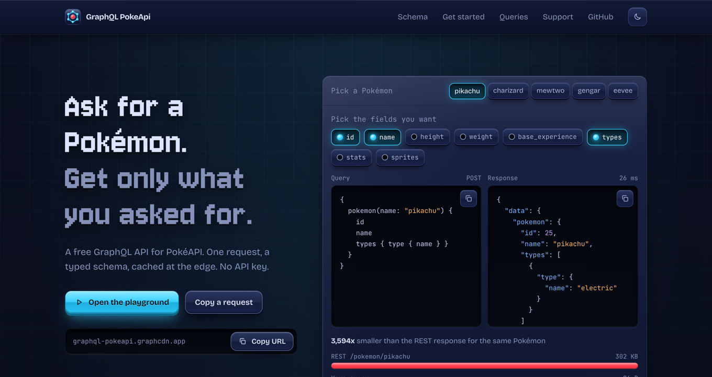

<p align="center">
  
</p>

<h1 align="center">GraphQL PokeApi</h1>

<p align="center">
  A free, typed and edge-cached GraphQL API for <a href="https://pokeapi.co">PokéAPI</a>.<br>
  Ask for a Pokémon. Get only what you asked for. No API key.
</p>

<p align="center">
  <a href="https://github.com/mazipan/graphql-pokeapi/actions/workflows/main.yml"></a>
  
  
  
</p>

<picture>
  <source media="(prefers-color-scheme: dark)" srcset="public/screenshot.png">
  <source media="(prefers-color-scheme: light)" srcset="public/screenshot-light.png">
  
</picture>

## Why use it

- **Ask for less.** Pick the fields you need. A `pokemon` query can be thousands of times smaller than the REST response.
- **One request.** Follow relations (types, moves, abilities, species) in the same query.
- **Typed schema.** Your editor can autocomplete every field.
- **Edge cached.** Repeat queries come from the edge, not from PokéAPI.
- **Free and open source.** MIT license. No sign-up, no API key.

## Quick start

```bash
curl -X POST https://graphql-pokeapi.graphcdn.app/ \
  -H 'Content-Type: application/json' \
  -d '{"query":"{ pokemon(name: \"ditto\") { id name } }"}'
```

```json
{ "data": { "pokemon": { "id": 132, "name": "ditto" } } }
```

Open the [homepage](https://gql-poke.mazipan.space) to try the live Query Lab, or the [playground](https://gql-poke.mazipan.space/api/graphql) to write your own queries.

## Endpoints

| Use                       | URL                                        |
| ------------------------- | ------------------------------------------ |
| Edge cached (recommended) | https://graphql-pokeapi.graphcdn.app/      |
| Origin                    | https://gql-poke.mazipan.space/api/graphql |
| Playground                | https://gql-poke.mazipan.space/api/graphql |
| Homepage                  | https://gql-poke.mazipan.space             |

> **GET requests:** the server blocks a plain `GET` as CSRF protection. Add the header `apollo-require-preflight: true`, or send a `POST` with `Content-Type: application/json`.

## Send a request

The [homepage](https://gql-poke.mazipan.space/#start) has copy-ready samples for Fetch, Apollo Client, urql, graphql-request, TanStack Query, Python and curl.

Runnable files are in [`examples/`](examples):

- WIP - [Fetch API - GET](examples/01-use-fetch-get.js)
- [Fetch API - POST](examples/02-use-fetch-post.js)
- WIP - [Apollo - GET](examples/03-use-apollo-get.js)
- [Apollo - POST](examples/04-use-apollo-post.js)

## Queries

All 28 queries. Most detail queries return `params`, `status`, `message` and `response`, where `response` is JSON. The `pokemon` and `pokemons` queries return typed fields.

| Query               | Description                     | Arguments                   |
| ------------------- | ------------------------------- | --------------------------- |
| `abilities`         | Get list of abilities           |                             |
| `ability`           | Get detail of ability           | `ability: String!`          |
| `berries`           | Get list of berries             |                             |
| `berry`             | Get detail of berry             | `berry: String!`            |
| `eggGroups`         | Get list of egg groups          |                             |
| `eggGroup`          | Get detail of egg group         | `eggGroup: String!`         |
| `encounterMethods`  | Get list of encounter methods   |                             |
| `encounterMethod`   | Get detail of encounter method  | `encounterMethod: String!`  |
| `evolutionChains`   | Get list of evolution chains    |                             |
| `evolutionChain`    | Get detail of evolution chain   | `id: String!`               |
| `evolutionTriggers` | Get list of evolution triggers  |                             |
| `evolutionTrigger`  | Get detail of evolution trigger | `name: String!`             |
| `genders`           | Get list of genders             |                             |
| `gender`            | Get detail of gender            | `gender: String!`           |
| `growthRates`       | Get list of growth rates        |                             |
| `growthRate`        | Get detail of growth rate       | `growthRate: String!`       |
| `locations`         | Get list of locations           |                             |
| `location`          | Get detail of location          | `location: String!`         |
| `moves`             | Get list of moves               |                             |
| `move`              | Get detail of move              | `move: String!`             |
| `natures`           | Get list of natures             |                             |
| `nature`            | Get detail of nature            | `nature: String!`           |
| `pokemons`          | Get list of Pokémon             | `limit: Int`, `offset: Int` |
| `pokemon`           | Get detail of Pokémon           | `name: String!`             |
| `regions`           | Get list of regions             |                             |
| `region`            | Get detail of region            | `region: String!`           |
| `species`           | Get list of species             |                             |
| `types`             | Get list of types               |                             |

Every query has a sample query, sample variables and a real result on the [homepage](https://gql-poke.mazipan.space/#reference).

## Query examples

### pokemons

<details>
  <summary>Sample query</summary>

```graphql
query pokemons($limit: Int, $offset: Int) {
  pokemons(limit: $limit, offset: $offset) {
    count
    next
    previous
    status
    message
    results {
      url
      name
      image
    }
  }
}
```

</details>

<details>
  <summary>Sample variables</summary>

```json
{
  "limit": 2,
  "offset": 1
}
```

</details>

<details>
  <summary>Sample result</summary>

```json
{
  "data": {
    "pokemons": {
      "count": 964,
      "next": "https://pokeapi.co/api/v2/pokemon/?offset=3&limit=3",
      "previous": null,
      "results": [
        {
          "url": "https://pokeapi.co/api/v2/pokemon/1/",
          "name": "bulbasaur",
          "image": "https://raw.githubusercontent.com/PokeAPI/sprites/master/sprites/pokemon/1.png"
        },
        {
          "url": "https://pokeapi.co/api/v2/pokemon/2/",
          "name": "ivysaur",
          "image": "https://raw.githubusercontent.com/PokeAPI/sprites/master/sprites/pokemon/2.png"
        },
        {
          "url": "https://pokeapi.co/api/v2/pokemon/3/",
          "name": "venusaur",
          "image": "https://raw.githubusercontent.com/PokeAPI/sprites/master/sprites/pokemon/3.png"
        }
      ],
      "status": true,
      "message": ""
    }
  }
}
```

</details>

### pokemon

<details>
  <summary>Sample query</summary>

```graphql
query pokemon($name: String!) {
  pokemon(name: $name) {
    id
    name
    abilities {
      ability {
        name
      }
    }
    moves {
      move {
        name
      }
    }
    types {
      type {
        name
      }
    }
    message
    status
  }
}
```

</details>

<details>
  <summary>Sample variables</summary>

```json
{
  "name": "ditto"
}
```

</details>

<details>
  <summary>Sample result</summary>

```json
{
  "data": {
    "pokemon": {
      "id": 132,
      "name": "ditto",
      "abilities": [{ "ability": { "name": "imposter" } }, { "ability": { "name": "limber" } }],
      "moves": [{ "move": { "name": "transform" } }],
      "types": [{ "type": { "name": "normal" } }],
      "message": "",
      "status": true
    }
  }
}
```

</details>

## Development

The project is a static homepage (`public/`) and Vercel Functions (`api/`). It needs Node 26 (see `engines.node` in `package.json`) and npm.

```bash
npm ci            # install
npm run build     # build the CSS and the homepage into public/
npm run serve     # build, then serve public/ on a local port
npm start         # run the functions with `vercel dev` (needs `vercel login`)
npx eslint .      # lint
```

| Path                      | What it does                                        |
| ------------------------- | --------------------------------------------------- |
| `api/graphql.js`          | Apollo Server 5 handler                             |
| `typeDefs/`, `resolvers/` | GraphQL schema and resolvers                        |
| `requests/`               | Calls to PokéAPI                                    |
| `public/`                 | Homepage template (`index.ejs`), styles, query data |
| `stellate.ts`             | Edge cache configuration                            |

Before you upgrade a dependency, read [AGENTS.md](AGENTS.md). Some packages are held back on purpose. Always test a Vercel preview deploy.

## Deploy on Vercel

[](https://vercel.com/new/clone?repository-url=https%3A%2F%2Fgithub.com%2Fmazipan%2Fgraphql-pokeapi)

## Apps using it

If you use `graphql-pokeapi`, add your app to [awesome-list.md](awesome-list.md).

## Credits

- [PokéAPI](https://github.com/PokeAPI/pokeapi)
- [Pokedex Promise V2](https://github.com/PokeAPI/pokedex-promise-v2)
- [Apollo Server](https://github.com/apollographql/apollo-server)
- [Stellate](https://stellate.co) for the edge cache
- [Vercel](https://vercel.com/)

## Contributors

Thanks to these wonderful people!


---

This is an unofficial project. It is not affiliated with Nintendo, The Pokémon Company or PokéAPI.

[MIT](LICENSE) © Irfan Maulana
